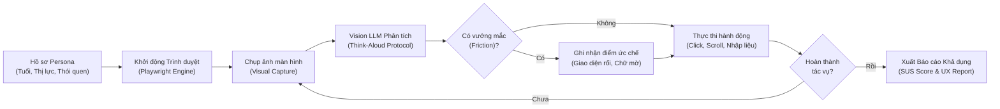

# 🤖 AI User-Tester (Synthetic Usability Testing Agent)

> **Dự án mô phỏng người dùng thật bằng AI (Vision LLM + Playwright) để kiểm thử trải nghiệm người dùng (UX Usability Testing) thông qua phương pháp "Nói ra suy nghĩ" (Think-Aloud Protocol).**

[](https://www.python.org/)
[](https://playwright.dev/)
[](https://openai.com)
[](LICENSE)

---

## 💡 1. Tại Sao Lại Cần AI User-Tester?

Trong quy trình phát triển sản phẩm web/app, có một khoảng trống lớn giữa việc **"Phần mềm chạy đúng kỹ thuật"** và **"Người dùng thấy dễ sử dụng"**:

| Tiêu chí | 🛠️ QA / Automation Tester truyền thống | 🧠 AI User-Tester (Dự án này) |
| :--- | :--- | :--- |
| **Mục tiêu chính** | Tìm lỗi chức năng (Bugs, Crash, Lỗi API, Console Error). | Tìm rào cản nhận thức (Cognitive Friction, Điểm gây ức chế, Chữ khó đọc). |
| **Cách tiếp cận** | Kiểm tra Pass / Fail theo các kịch bản viết sẵn (Test-cases). | Đóng vai các nhóm người dùng khác nhau (Personas) và tự do khám phá. |
| **Cách nhìn màn hình**| Đọc mã nguồn HTML / DOM / XPath để tìm selector. | **Dùng mắt nhìn (Computer Vision)** chụp ảnh màn hình như mắt người. |
| **Kết quả đầu ra** | Danh sách lỗi kỹ thuật (Issue log, Stacktrace). | **Báo cáo cảm nhận (Think-Aloud Log), Điểm khả dụng (SUS Score) và đề xuất UX.** |

---

## 📚 2. Tổng Hợp Các Dự Án & Nghiên Cứu Hàng Đầu Thế Giới

Dự án này được tổng hợp và kế thừa từ những nghiên cứu mở nổi bật nhất hiện nay về AI Usability:

1. **[neuhai/UXAgent](https://github.com/neuhai/UXAgent):** Hệ thống nghiên cứu học thuật hàng đầu về việc sử dụng LLM Agent kết hợp Playwright để thực hiện usability testing tự động, ghi nhận luồng tư duy và xuất khảo sát sau thử nghiệm.
2. **[UXCascade](https://github.com/hailab-ui/UXCascade):** Nền tảng kiểm thử trải nghiệm theo nhiều persona, tự động trích xuất các rào cản thao tác dựa trên log Think-Aloud và cấu trúc DOM.
3. **[Avenir-UX](https://github.com/neuhai/Avenir-UX):** Framework tự động chấm điểm độ dễ dùng (SEQ) và tổng hợp báo cáo System Usability Scale (SUS) quy mô lớn.
4. **[de6eling/user-testing-agent](https://github.com/de6eling/user-testing-agent):** Công cụ mô phỏng luồng di chuyển của người dùng trên web theo nhiệm vụ mục tiêu.
5. **[browser-use/browser-use](https://github.com/browser-use/browser-use):** Thư viện điều khiển trình duyệt thông minh bằng thị giác mạnh mẽ nhất hiện nay.

---

## 🏛️ 3. Kiến Trúc & Cơ Chế Hoạt Động (Architecture)



### 4 Trụ Cột Phương Pháp Luận:
1. **Persona Modeling:** Định hình cụ thể đối tượng kiểm thử (Bác lớn tuổi 58 tuổi, sinh viên vội vã 22 tuổi, kỹ sư khó tính 30 tuổi).
2. **Visual Think-Aloud Protocol:** Ở mỗi màn hình, AI buộc phải tự trả lời 4 câu hỏi:
   * *Đập vào mắt tôi đầu tiên là gì?*
   * *Tôi có hiểu trang này đang muốn tôi làm gì không?*
   * *Có chỗ nào làm tôi khựng lại, bối rối hoặc khó chịu không?*
   * *Hành động tiếp theo tôi muốn làm là gì?*
3. **Cognitive Friction Classification:** Phân loại mức độ ma sát (None, Low, Medium, High).
4. **System Usability Scale (SUS):** Chấm điểm 10 câu hỏi tiêu chuẩn quốc tế để ra thang điểm từ 0 đến 100.

---

## 🚀 4. Hướng Dẫn Cài Đặt & Chạy Nhanh Trong 60 Giây

### Bước 1: Clone repo về máy
```bash
git clone https://github.com/Skill-AI-private/User-tester.git
cd User-tester
```

### Bước 2: Cài đặt thư viện
```bash
pip install -r requirements.txt
playwright install chromium
```

### Bước 3: Thiết lập API Key (Tùy chọn)
Tạo file `.env` từ file mẫu:
```bash
cp .env.example .env
```
*(Nếu chưa có API Key, hệ thống sẽ tự động kích hoạt **Chế độ Demo Thông Minh** để bạn xem trước luồng hoạt động).*

### Bước 4: Chạy kiểm thử
```bash
# 1. Chạy test với Persona Người lớn tuổi (Bác Ba)
python main.py --url https://news.ycombinator.com --persona senior_user

# 2. Chạy test với Persona Bạn trẻ mua sắm bận rộn
python main.py --url https://example.com --persona busy_shopper --goal "Tìm nút mua hàng"

# 3. Chạy ở chế độ ẩn trình duyệt (Headless)
python main.py --url https://example.com --headless
```

---

## 📂 5. Cấu Trúc Dự Án (Project Structure)

```text
User-tester/
├── personas/                     # Thư viện hồ sơ người dùng mẫu
│   ├── senior_user.yaml          # Bác Ba (58 tuổi, mắt kém, cẩn trọng)
│   ├── busy_shopper.yaml         # Minh (22 tuổi, lướt nhanh, thiếu kiên nhẫn)
│   └── tech_savvy.yaml           # Alex (30 tuổi, kỹ sư phần mềm khó tính)
├── src/
│   ├── agent.py                  # Agent điều khiển Playwright & Vision AI
│   ├── prompts.py                # Kịch bản Think-Aloud & Nielsen Heuristics
│   └── reporter.py               # Thuật toán tính điểm SUS & xuất Markdown
├── reports/                      # Thư mục lưu trữ báo cáo tự động
│   └── sample_ux_report.md       # Báo cáo mẫu tham khảo
├── main.py                       # Điểm khởi chạy CLI
├── requirements.txt              # Danh sách thư viện Python
├── .env.example                  # Mẫu cấu hình môi trường
└── README.md                     # Tài liệu dự án
```

---

## 📊 6. Kết Quả Đầu Ra Mẫu (Sample Deliverable)

Sau mỗi phiên kiểm thử, bạn sẽ nhận được một file Markdown trực quan trong thư mục `reports/` bao gồm:
* **Thang điểm SUS (0-100)** kèm xếp loại (Hạng A, B, C, D, F).
* **Danh sách các điểm nghẽn (Friction Points):** Chỉ rõ vị trí pop-up che khuất, nút bấm thiếu độ tương phản, hoặc form đăng ký quá dài.
* **Bảng nhật ký từng bước:** Chi tiết ấn tượng thị giác và hành động của AI.
* **Khuyến nghị thiết kế (Actionable Recommendations):** Giúp đội ngũ Designer/Frontend sửa ngay lập tức.

👉 *Xem báo cáo mẫu chi tiết tại [reports/sample_ux_report.md](reports/sample_ux_report.md).*

---

## 🤝 Đóng Góp & Bản Quyền
Dự án được phân phối dưới giấy phép **MIT License**. Mọi đóng góp về persona mới hoặc cải tiến prompt Think-Aloud đều được hoan nghênh!
